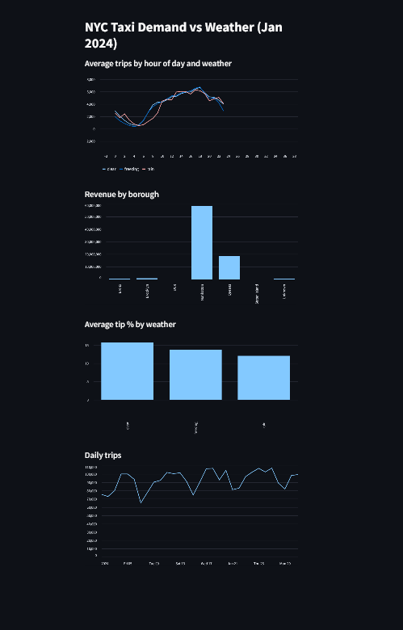
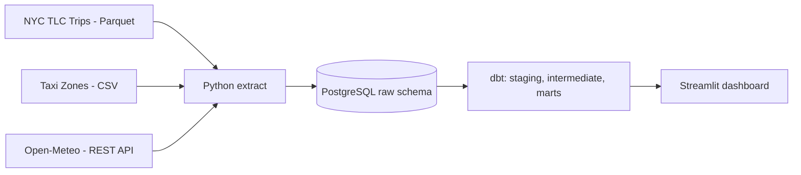
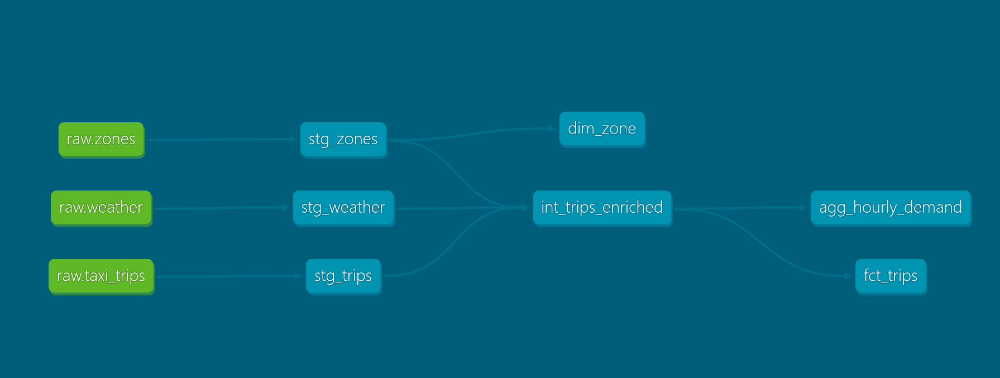

# NYC Taxi + Weather Data Pipeline

An end-to-end ELT pipeline that ingests **~3 million NYC taxi trips** and hourly weather data, models them into an analytics-ready star schema with **dbt**, validates them with automated data quality tests, and serves insights through a **Streamlit** dashboard.

**Tech stack:** Python · PostgreSQL · Docker · dbt · SQL · Streamlit · GitHub Actions

---

## The question this project answers

> **How does weather affect NYC taxi demand, tips and revenue?**

The pipeline joins every taxi trip (January 2024) to the weather during its pickup hour, so demand, tips and revenue can be compared across clear, rainy and freezing conditions.

## Dashboard



## Architecture



| Stage | What happens |
|---|---|
| **Extract** | Python downloads trips (Parquet), zone names (CSV) and hourly weather (REST API, 744 hourly rows). Existing files are skipped. |
| **Load** | Raw data lands untouched in a `raw` schema in PostgreSQL running in Docker. Reloading replaces the tables, so no duplicates. |
| **Transform** | dbt builds `staging` (clean and rename), `intermediate` (join trips, zones and weather) and `marts` (final tables). |
| **Serve** | A Streamlit dashboard reads the marts and shows demand, revenue and tips by weather. |

## Data model

| Table | Description |
|---|---|
| `fct_trips` | One row per cleaned trip: pickup time, zones, distance, fare, tip, duration, weather category |
| `dim_zone` | Zone name and borough |
| `agg_hourly_demand` | Trips, revenue, average distance and tip % per hour, borough and weather category |



## Data quality

- **2,964,624** raw trips became **2,869,585** after cleaning. **95,039 invalid rows (3.2%)** were removed: negative fares, zero distance, trips ending before they start, and dates outside January 2024.
- **9 automated dbt tests** check uniqueness, non-null keys, valid zone references and accepted weather categories.
- Linting (ruff) and unit tests (pytest) run through GitHub Actions on every push.

## Engineering practices

- **Idempotent:** re-running extract and load gives the same result, never duplicates.
- **Reproducible:** PostgreSQL runs in Docker and dependencies are pinned (`dbt-core==1.8.8`, `dbt-postgres==1.8.2`).
- **Secure:** credentials live in `.env`, which is git-ignored. Only `.env.example` is committed.
- **Layered modeling:** staging, intermediate and marts keep each step simple and testable.
- **Automated checks:** GitHub Actions runs linting and tests on every push.

## How to run it

**Requirements:** Python 3.11+, Docker Desktop, Git

```bash
git clone https://github.com/Medhasshetty/nyc-taxi-weather-pipeline.git
cd nyc-taxi-weather-pipeline
python -m venv venv
venv\Scripts\activate          # Mac/Linux: source venv/bin/activate
pip install -r requirements.txt
copy .env.example .env         # Mac/Linux: cp .env.example .env
```

Create a dbt profile named `dbt_project` in `~/.dbt/profiles.yml` with: type `postgres`, host `localhost`, port `5432`, the user, password and dbname from your `.env`, and schema `analytics`.

Then run the pipeline:

```bash
docker compose up -d
python src/extract.py
python src/load.py             # about 10 minutes for 2.9M rows
cd dbt_project
dbt run
dbt test
cd ..
streamlit run dashboard/app.py
```

On Windows you can run the whole pipeline with `.\run_pipeline.ps1`.

## Project structure

```
├── src/                  extract.py, load.py
├── dbt_project/models/   staging, intermediate, marts
├── sql/analysis.sql      analysis queries
├── dashboard/app.py      Streamlit dashboard
├── tests/                pytest tests
├── docs/                 screenshots
├── docker-compose.yml
└── .github/workflows/    CI
```

## What I learned

- Building a complete ELT flow from three different sources: Parquet, CSV and a REST API.
- Designing idempotent loads and keeping secrets out of Git.
- Why data is cleaned in a staging layer, and how dbt layers and tests make pipelines easier to trust.
- Debugging real setup problems, such as the SQLAlchemy driver error fixed by using `postgresql+psycopg2://`.

## Next steps

- Schedule the pipeline with Apache Airflow
- Move storage to GCS and the warehouse to BigQuery, and load 12 months of data
- Add incremental dbt models
- Build a real-time streaming version with Kafka and Spark

## Author

Medha · [GitHub](https://github.com/Medhasshetty)